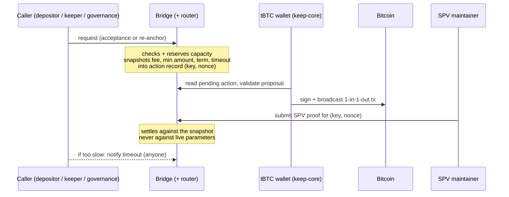
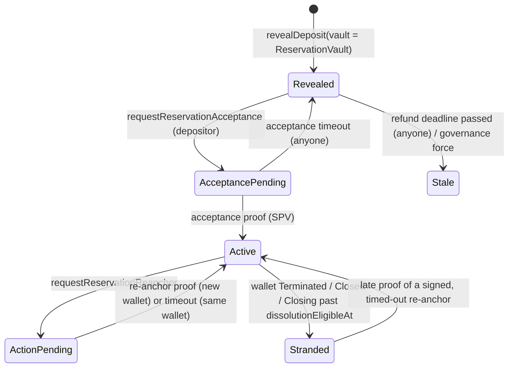
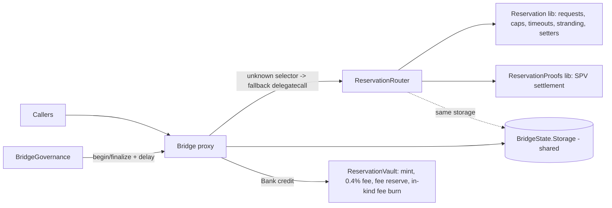

# M1 UTXO reservations - a guide for explaining it with confidence

Written 2026-10-12 from the current code and spec, not from memory.
- Contracts: tbtc-v2 the integrated reservation branch @ `9d208696` (worktree `tbtc-v2-resv-merge`). It includes the third-party hold cap and the feasibility guard.
- Client: keep-core `f99ef96e3` (the drill build).
- Spec: keep-core `docs/reservations-spec-reanchor-cap` (`docs/spec/reservations/`; the `pr-4282-spec` worktree was removed 2026-10-15, recreate with `git worktree add <path> docs/reservations-spec-reanchor-cap`).
- Research notes with full file:line citations: `local://m1-research-{spec,contracts,client}.md` (session-local).

When the spec and the code disagree, the code wins. Section 12 lists the known drift.

---

## 0. The 60-second version

- **Problem.** In tBTC today, a deposit is swept into the wallet's single main UTXO. The depositor holds a share of a pool, not their own coin.
- **What a reservation is.** A reservation keeps one deposit's Bitcoin in its own UTXO (the **anchor**), held by a tBTC wallet and never mixed into the pool. The depositor still gets TBTC 1:1 (minus a 0.4% fee).
- **Why.** Later (M2), the owner can get that exact Bitcoin back ("in-kind redemption"), with a clean 1-input-1-output history.
- **M1 is "rails, not product".** In M1 you can create a reservation, hold it, and move it between wallets (re-anchor). You cannot redeem it in kind, renew it or close it. The owner's TBTC is ordinary TBTC: they can sell it or redeem it through the normal pool.
- **How every action works:** request on Ethereum, then sign the Bitcoin transaction, then prove it. A request reserves capacity and freezes the rules ("snapshot"). The wallet signs a 1-in-1-out Bitcoin transaction. An SPV maintainer proves it on Ethereum. If nobody acts in time, anyone can call a timeout.
- **Safety by absence.** The M2 functions (redemption, renewal, dissolution, veto) are not in the M1 code at all. They are not switched off; they do not exist.
- **Launch is two-sided.** Contracts deploy "inert". Activation needs a keep-core build that knows the activation block, then governance calls `setVaultStatus(vault, true)` at or after that block.

---

## 1. Three different "M0"s - get this right first

People use M0/M1/M2 for three different things. Name which one you mean.

| Name | Where | Meaning |
|---|---|---|
| **Protocol milestones** | `roadmap.md` | **M1** = create-only rails (variant B). **M2** = in-kind redemption, renewal, dissolution, veto, a new vault and a migration. There is **no protocol M0**. |
| **keep-core readiness plan** | `m1-keep-core-readiness/04-implementation-plan.md` | **Milestone 0** = unblock ABI verification: merge the tbtc-v2 A-G stack and republish the npm package so keep-core generates bindings from real artifacts. A vendored ABI fallback (`64d0e6937`) works around it; the real npm publish still waits on tbtc-v2 #1116. That plan's M1/M2/M3 are its own task phases. |
| **Our epic tracker** | `docs/plans/reservations-epic-tracker.md` on `reservations-epic` | **M0** review-fix rounds merged (#4324, #4343, #4346, #1161). **M1** audit and drill blockers. **M2** tests and fork dry-runs. **M3** Sepolia deploy script. **M4** Sepolia deploy (next). **M5** drill. **M6** publish and reconcile with `dev`. **M7** mainnet readiness. |

The tracker and the protocol both use "M1" and "M2" for different things. In conversation, say "protocol M1" or "tracker M4".

---

## 2. Who is involved

| Actor | What they do | Trust |
|---|---|---|
| **Depositor / owner** | Sends BTC to a deposit address, reveals it with `vault = ReservationVault`, then calls `requestReservationAcceptance` (**only the depositor may call it**, `Reservation.sol:511-513`). Becomes `reservation.owner` and receives TBTC. | Untrusted; the contracts check everything. |
| **tBTC wallet (operators)** | Threshold-signs the anchor and re-anchor Bitcoin transactions. The keep-core coordinator proposes them; followers validate before co-signing. | Same as pooled tBTC custody (honest majority). |
| **SPV maintainers** | The only callers of the two proof functions (`onlySpvMaintainer`). Run keep-core's maintainer process. | Allow-listed; cannot forge a proof. |
| **Governance** (BridgeGovernance, owned by the Council Safe/Timelock on mainnet, the deployer EOA on Sepolia) | Sets parameters and caps with a delay. Wires the router once. Activates the vault. Is the only one allowed to move a reservation off a healthy `Live` wallet. | Trusted. |
| **Anyone (keepers)** | Timeouts, stale-deposit release, stranding, fee-debt repayment. No reward; the contract checks every step. keep-core runs watchers for these. | Untrusted. |

---

## 3. The core idea: request, sign, prove

This is the most important concept. The first design had one step, and a security review traced most of its findings to that. It has two steps now, like pooled redemptions.

Why each part matters:
- **Nonce ("generation").** Every request increments `requestNonce`. Each attempt is stored as `reservationActions[keccak(reservationKey, nonce)]`, so an old attempt is never confused with a new one.
- **Snapshot.** The fee cap, minimum amount, term and dissolution delay are copied into the action record. Governance can change parameters at any time, and a transaction the wallet already signed still proves.
- **Caps are checked only at request time.** Full caps never block the proof of a confirmed Bitcoin transaction.
- **Late proofs.** A timed-out attempt can still be proven later. It takes the capacity back, and there is never a second refund. The window is bounded for acceptance: a late acceptance proof reverts after `timeoutAt + termSeconds` ("Late acceptance settlement window expired", `ReservationProofs.sol:204-211`). A late re-anchor proof has no time limit while the source anchor is still current.
- **Fee shortfalls never block settlement.** If the vault's fee reserve is empty, the shortfall becomes public debt instead of a revert. This is not a promise that every confirmed transaction settles: see the late-acceptance bound above.

---

## 4. The lifecycle, step by step

On-chain, the reservation's `state` is `Unknown` until acceptance settles (the "Revealed" and "AcceptancePending" boxes above). `Closed` exists in the enum but nothing in M1 reaches it.

### 4.1 Reveal (`Deposit.sol:198-421`)
- On Bitcoin, the depositor pays the normal tBTC deposit script (P2SH or P2WSH). The only difference is on Ethereum: the reveal names `ReservationVault`.
- The Bridge marks the deposit as reserved **permanently**, records the designated wallet and the exact refund locktime, and increments `pendingReservedDeposits`.
- **Refund-locktime rule:** `now + revealAhead <= refundDeadline <= now + term + 24h`. The upper bound means a deposit that is never accepted can always be cleaned up, instead of blocking governance forever.
- No SPV proof is needed at reveal. Ordinary sweeps refuse reserved deposits, both on-chain (`WalletProposalValidator`, "Reserved deposits must not be swept") and in keep-core (the `IsReservedDeposit` filter).

### 4.2 Acceptance request (`Reservation.sol:505-641`)
- **Caller:** the depositor only.
- **Checks:**
  - The wallet is the designated wallet and is `Live`.
  - `amount > minAmount + 2 * txMaxFee`. An anchor that pays the full fee then still clears the re-anchor floor, so the first hand-off is always possible. On Sepolia (min 10,000, fee 1,000) the smallest reservable deposit is 12,001 sat.
  - There is a signing window: at least 2 h after reveal, it ends 2 h before the action timeout, and the timeout plus 24 h must still be before the refund deadline.
  - Single-amount cap, then capacity: global count (`maxActiveReservations`), global amount, per-wallet count and per-wallet amount.
- **Effect:** a `Pending` Acceptance action with all the snapshots.

### 4.3 Anchor transaction and proof (`ReservationProofs.sol:346-632`)
- **The Bitcoin transaction:** 1 input (the deposit) and 1 output (P2WPKH to the designated wallet). Fee at most the snapshotted `txMaxFee`. The output must be at least the snapshotted `minAmount`.
- **The proof:** an SPV maintainer calls `submitReservationAcceptanceProof`. The deposit is marked swept, so no ordinary sweep can take it.
- **The position written:**
  - `owner = depositor`, and `mintedAmount = anchorAmount`: the "claim equals anchor" invariant.
  - `expiresAt = now + snapshotted term`, and `dissolutionEligibleAt = expiresAt + delay`.
  - `state = Active`.
- **Minting:** the Bank credits the gross amount to the vault, which mints TBTC. The owner gets gross minus `initiationFeeBps` (default 40 = 0.4%, `ReservationVault.sol:135`). The fee stays in the vault as the **fee reserve**.
- **If governance has revoked the vault's trust** before a late proof arrives, the depositor is credited directly, with no fee.
- **If the wallet left `Live`** before settlement, the new position is stranded at once.

### 4.4 Custody
The anchor is a separate wallet UTXO, not part of the main UTXO. Moving funds does not move it; only re-anchor does. A wallet that still holds anchors cannot finish closing ("Wallet still custodies reservations").

### 4.5 Re-anchor (`Reservation.sol:663-910`, proof at `ReservationProofs.sol:656-765`)
- **Who may call it:**

  | Source wallet state | Allowed callers |
  |---|---|
  | `Live` | Governance only ("Only governance can rotate a Live wallet's anchor") |
  | `MovingFunds` or `Closing` | Anyone; this is the main way to free a reservation from a retiring wallet |

- **Privileged callers** are governance, the owner, SPV maintainers, and proven source-wallet members. For a `MovingFunds` or `Closing` source, their request may exceed the target's count and amount caps. Capacity is still booked. A governance rotation from a Live source retains both caps.
- **Third parties** retain ordinary target caps and the limit on pending holds. Only the governance-discriminated call bypasses the cooldown. A pending action on the same reservation still prevents a new request.
- **Floor:** `anchorAmount > txMaxFee + minAmount`. It is the only limit on fees eaten by repeated hops.
- **No time limit:** re-anchor works at any position age. This is deliberate (see section 6).
- **The Bitcoin transaction:** 1 input (the current anchor) and 1 output (P2WPKH to the target wallet).
- **On proof:** the claim shrinks by the miner fee (`mintedAmount = newAnchorAmount`) and `cumulativeReanchorFee` grows. **Last**, the vault's `financeInKindFee` burns TBTC equal to the fee, so supply keeps tracking Bitcoin. If the reserve is short, the gap becomes `inKindFeeDebtSat`. Anyone can repay it, and `sweepFees` repays it first.

### 4.6 Timeouts (no slashing in M1)
- **Acceptance timeout** (`notifyReservationAcceptanceTimedOut`, anyone): all capacity is released and the position stays `Unknown`. The depositor can request again. A late proof still settles until `timeoutAt + termSeconds`.
- **Re-anchor timeout** (`notifyReservationActionTimeout`, anyone): target capacity is released and the position goes back to `Active` on the source wallet. Every re-anchor timeout starts a cooldown as long as the action's signing window (`Reservation.sol:984-986`). During it, only a governance call can request a new re-anchor; the owner, SPV maintainers, wallet members (including keep-core's re-anchor task) and third parties all wait (`Reservation.sol:758-763`). A late proof is accepted with no time limit, as long as the source anchor has not changed.

### 4.7 Stale reserved deposits
- **Never accepted, refund deadline passed:** anyone calls `notifyStaleReservedDeposit`.
- **Griefing:** governance can call `forceStaleReservedDeposit` at any time.
- After either call, the depositor uses the normal Bitcoin refund path.

### 4.8 Stranding (the accepted worst case)
- **When:** the custodying wallet is `Terminated`, `Closed`, or `Closing` with `now >= dissolutionEligibleAt`.
- **Effect:** `notifyReservationStranded` (anyone; keep-core's watcher does it) flips the position to `Stranded` and releases capacity. **The owner's TBTC does not change.** What they lose is the in-kind option. The shortfall is shared by all TBTC holders.
- **One way back:** a late proof of an already-signed, timed-out re-anchor restores the position as `Active` on its target.
- **Not built:** an emergency exit, which was rejected on cost (`exit/README.md`). The build plan is Tier 0 (stranded-liability accounting) and Tier 1 (refunding fees paid on stranded positions).

### 4.9 Term end
In M1, **nothing happens at `expiresAt`**. The term is a "promise clock" stored for M2. Its only reader in M1 is the Closing-wallet stranding rule. If M2 has not shipped by a position's `dissolutionEligibleAt`, its in-kind option quietly lapses. That is why the term is 12 months, roughly twice a realistic M2 date.

---

## 5. Contract architecture

- **Why a router:** the Bridge is near the 24,576-byte EIP-170 limit; it is 23,567 bytes after our guard, which leaves 1,009. The router is Bridge code reached by `delegatecall`, so it runs on Bridge storage with Bridge authority, but has its own size budget.
- **Router rules:** it has no state of its own; it cannot shadow a Bridge selector; called directly it reverts; `setReservationRouter` works **once**. Replacing router code means a Bridge proxy upgrade.
- **Vault:** plain `Ownable`, **not upgradeable**, 7 external functions, no redemption or renewal. Once any reservation exists, it cannot be replaced: re-pointing needs `reservationTotalAmount == 0` and `pendingReservedDeposits == 0`. This is the "Option B" vault decision (2026-09-24): M2 deploys a new vault and asks depositors to migrate.
- **Storage:** only appended to `BridgeState.Storage`, with a `__gap`. Fields M2 needs (`dissolutionEligibleAt`, `retryCredit`, and others) are already written in M1 so M2 has the data.

---

## 6. Why M1 looks like this (variant B)

The 2026-08-21 decision chose B over A+. They differ in one feature: **dissolution**.
- **Dissolution would let anyone open a dissolution after eligibility.** If keep-core did not sign it in time, anyone could time it out and **slash honest operators**. B removes the function, so this attack does not exist.
- **The price of removing dissolution:** the owner cannot close a position. It ends only by stranding: when its wallet dies (`Terminated`), or after a normal close (`Closed`, or `Closing` past `dissolutionEligibleAt`). Slots are never freed by the owner, so caps are "cumulative ever". There is no exit for the owner.
- **Re-anchor therefore had to lose its time limit.** Otherwise a position past eligibility could never move. This is why re-anchor is unbounded, and why the keep-core re-anchor task is critical.
- **Main residual risk: saturation.** If every target wallet is full, re-anchor has nowhere to go, the retiring wallet cannot close, and its moving-funds timeout can slash honest operators and strand depositors. The defence is the global cap `maxActiveReservations` (the launch gate) plus `maxReservationsPerWallet = 1`, kept below the free-slot supply.

Other facts worth knowing:
- **A close that only updates the books is unsound.** It would create a real Bitcoin shortfall. Any sound way to release a position must move BTC and prove it.
- **The wallet-retirement exit is automated.** After the last re-anchor off a `MovingFunds` wallet, keep-core files `notifyMovingFundsBelowDust` so the wallet can close cleanly.

---

## 7. Parameters, caps and the guards

| Parameter | Meaning | Rule | Sepolia drill value |
|---|---|---|---|
| `reservationTxMaxFee` | Max miner fee per anchor or re-anchor (snapshotted) | > 0 | 1,000 sat |
| `reservationMinAmount` | Minimum anchor | > txMaxFee | 10,000 sat |
| `reservationTermSeconds` | Promise clock | 90-730 days | 90 days (mainnet plan: 12 months) |
| `reservationDissolutionDelay` | `dissolutionEligibleAt = expiresAt + delay` | - | 86,400 s |
| `reservationRenewalWindowSeconds` | M2 only; stored | > 0 and < term | 86,400 s |
| `reservationActionTimeout` | Signing window per action | > 2 h | 86,400 s |
| `maxReservationsPerWallet` | Per-wallet count | > 0 (mainnet plan: 1) | 1 |
| `reservationMaxTotalAmount` | Global amount cap | Decision-1 rule (below) | 4,000,000 sat |
| `maxReservationsAmountPerWallet` | Per-wallet amount cap | 0 = off | 2,000,000 sat |
| `reservationMaxSingleAmount` | Per-position cap at acceptance | - | 2,000,000 sat |
| `maxActiveReservations` | Global count: **the launch gate** (0 blocks all acceptances) | > 0, and well below `liveWalletsCount x maxReservationsPerWallet` so retiring wallets can hand off | 2 (4 Live wallet slots) |
| `maxThirdPartyReanchorHoldsPerWallet` | Pending third-party re-anchors per target | 0 = third parties cannot hold any | 1 |
| `handoffReserveWallets` | Live-wallet capacity excluded from new admission | > 0; acceptance budget is `max(0, Live count - reserve) * per-wallet count` | 2 |
| Vault `initiationFeeBps` | Fee at mint | <= 500 | 40 (default) |
| Vault `feeReserveTarget` | Reserve kept before sweeping fees to the treasury | - | 0 (D21) |

- **Decision-1 rule:** `maxTotal <= maxActive * maxSingle`.
- **Feasibility guard (our D25, `BridgeState.sol:681-712`):** while a vault is set, the reservation parameter setter, the caps setter and `updateDepositParameters` all revert if reserved deposits would become impossible:
  - `revealAhead > term + 24h`, or
  - any non-zero amount cap below dust.

  Why this exists: earlier example values made every reserved deposit impossible (mainnet dust is 0.01 BTC and reveal-ahead is 150 days).
- **Order of setup:** caps before parameters, because the parameters check reads the caps. All changes go through begin/finalize with the governance delay: 60 s on Sepolia, 48 h on mainnet.

---

## 8. The client (keep-core)

Three roles. They run in two processes: the client and the maintainer.

1. **Coordinator and proposal generator** (`pkg/tbtc`, `pkg/tbtcpg`):
   - Every 900 blocks, a leader runs a checklist. `ReservationAnchor` and `ReservationReanchor` are on it every window once activation is reached, before the heartbeat.
   - The **acceptance task** scans `ReservationAcceptanceRequested` events in chunks, checks the candidates (at most 50 per run, 8 workers), estimates a fee, builds the anchor transaction, and checks it on-chain with `ValidateReservationAnchorProposal`.
   - The **re-anchor task** covers sources in `MovingFunds` or `Closing`. It resumes a pending request, or sends at most one new request per pass with a member proof (cap exemption). Targets must be `Live`, past their creation period, and have room.
   - **Follower checks:** re-read the chain, call the on-chain validator, then two fee gates: a hard reject below 5 sat/vB, and a warning below the operator's floor.
2. **SPV maintainer** (`pkg/maintainer/spv`):
   - A dedicated proof loop that scans from the activation block in 10,000-block chunks and stays 12 blocks behind the tip.
   - Matches 1-in-1-out transactions, including fee-bumped replacements, keeps timed-out attempts while they can still settle, and submits the proofs.
3. **Watchers** (anyone may do these; both processes run them): stranding, stale deposits, action timeouts. Each operator waits a different offset before the first call, so they do not all send at once.

**Activation (rule C-4):**
- `reservationsActivationBlocks` (`pkg/tbtc/coordination.go:129`) is empty in the drill build. `Developer` is 0; every other network gets "never" (MaxUint64).
- Ship the client with block B for the network **before** `setVaultStatus(vault, true)`, and activate at or after B. Otherwise reserved deposits arrive on-chain and no client ever accepts them.
- The gate comes from the network and the block, not from a config flag, so leader and followers always agree during a rolling upgrade.

**Operator flags:** `Tbtc.ReservationsEnabled` (proposals and watchers) and `Maintainer.Spv.ReservationProofsEnabled` (proofs). Both must be on; a deploy check fails if they differ.

**Metrics to watch:**

| Metric | Meaning |
|---|---|
| `active_reservations_count` vs `max_active_reservations` | Occupancy |
| `reservation_vault_fee_debt_sat` | Rising means re-anchor fees outrun the reserve |
| `reservation_params_infeasible` = 1 | No reserved deposit is possible (our D25 alarm) |
| `spv_reservation_watcher_deaths_total` > 0 | A watcher died |
| `spv_reservation_action_overdue_total` | Actions that went overdue |
| `reanchor_waiting_on_aged_target` | Re-anchors wait for a target wallet to age |
| `reservation_*_proof_*` | Proof submission counters |

---

## 9. What M1 does not do (say this plainly)

- No in-kind redemption (whole or partial), no renewal, no dissolution, no watchtower veto, no retry credit. The code for these is absent.
- **No exit for the owner.** The owner keeps fungible TBTC and can use the pool. The in-kind right waits for M2.
- **No slashing** on acceptance or re-anchor timeouts.
- **Not built yet:** the wallet allowlist for reservations (decided, not implemented), and a limit on cumulative re-anchor fees.
- **Re-anchor off a `Closing` wallet runs inside the coordinator's re-anchor task** (`pkg/tbtcpg/reservation_reanchor.go:170-174`), the same as for `MovingFunds`. It is not a separate watcher, so it stops when the coordination windows stop. No keep-core component calls `notifyWalletClosingPeriodElapsed`.

## 10. M2 in one paragraph

M2 brings back redemption, renewal, veto and retry credit (about 3,000 Solidity lines), partial redemption (about 700) and dissolution (about 900). Because the M1 vault is minimal and cannot be upgraded, M2 needs a **new vault plus a depositor opt-in migration**, and a Bridge upgrade that changes the vault-binding rule. Open M2 questions:
- Does re-anchor get a time limit again?
- Do M1-era positions get M2 rules? Their dates are frozen under M1 parameters.

---

## 11. Where we are (our work)

Epic tracker (public): `docs/plans/reservations-epic-tracker.md` on `reservations-epic`.

| Stage | State |
|---|---|
| Audit plus fixes for the reservation findings, each with a failing-first test | Done. Includes the third-party hold cap (#190), the feasibility guard, the lint ban and the client alarm |
| Mainnet-fork dry-runs | Done: activation 22/22, reveal plus acceptance 25/25 |
| Sepolia deploy script with live signer and resumable phases | Done, rehearsed |
| **Next** | You run `PHASE=prepare` on Sepolia, then npm publish, then agent sets block B and builds the client, then the operators upgrade, then `PHASE=activate` |
| Then | The drill (M5), publishing the fixes after the drill (M6), and before mainnet (M7): decide the remaining #190 limit, launch values that pass the guard, and the bytecode budget |

---

## 12. Doc vs code drift (so nobody catches you out)

Resolved 2026-10-12 in the reservation specification work (it goes public with the fixes after the drill). If you read the public `docs/reservations-spec`, these points are still wrong there:

1. `feature-spec.md` describes the **full** feature (the M2 target), not M1. Its top banner already lists the M1 differences; no change was needed.
2. `roadmap.md` §0.2 called acceptance "permissionless". Now corrected: depositor-only in M1.
3. `requirements.md` lacked `maxThirdPartyReanchorHoldsPerWallet` and `pendingThirdPartyReanchorHolds`. Now in FR-29 and the §9 cap table.
4. The keep-core readiness docs listed "no stranding trigger for a Closing wallet past eligibility" as an open Major gap. Now marked resolved (`checkReservationStrandingForClosingWallet`, fixed in `41fb820a5`).
5. The readiness docs said re-anchor proofs are found through `ReservationByAnchorUtxo`. Now corrected: the proof loop matches on the re-anchor request events (outpoint plus fee).
6. EIP-170 figure: NFR-GAS-1 now says 23,567 B with 1,009 B left (measured on `84ea4dda`). The older 22,914 B figures in other files are kept as dated history, each with a re-measurement note.
7. `pr-strategy.md` row F now says inline that the pause-flag plan was superseded by Option B.
8. New: NFR-SEC-5 said a timed-out generation "MUST remain late-settleable" with no limit. It now states the acceptance bound (`timeoutAt + termSeconds`) and what happens after it.

---

## 13. Questions you will get, with short answers

- **"Can a reservation holder get their BTC back in M1?"** Not in kind. They have normal TBTC and can redeem from the pool or sell it. In-kind redemption is M2.
- **"What stops a wallet from stealing the anchor?"** The same thing that protects pooled funds: honest-majority threshold signing, and fraud challenges against wallet signatures that no pending authorization covers. Each anchor outpoint is indexed (`reservationsByAnchorUtxo`), and a proven move marks it spent (`spentMainUTXOs`), so only an authorized, proven 1-in-1-out move counts as honest.
- **"What if the wallet never signs the acceptance?"** Anyone times it out, capacity is released, and the depositor can request again. If it never gets accepted, the deposit goes stale after its refund deadline and the depositor refunds on Bitcoin.
- **"Can governance change the rules on a pending action?"** No. Settlement uses the snapshot taken at request time.
- **"Why can't you just close a reservation in M1?"** A close that only updates the books on a live wallet creates a real shortfall. Releasing must move BTC and prove it. Dissolution does that, and it was cut to remove the slashing attack.
- **"What is the worst realistic failure?"** A retiring wallet can still lack an available signing quorum or a surviving Live target. The admission reserve limits new positions, and privileged hand-offs may exceed ordinary target caps. Neither rule guarantees signing or proof delivery. Monitor wallet availability, action deadlines and concentration, not only `active_reservations_count`.
- **"Why a router? Isn't delegatecall risky?"** It exists for the size limit. The risks are covered by storage-parity tests, a ban on selector shadowing, no standalone authority, and a one-time setter. Upgrades still go through the Bridge proxy admin.
- **"Why can't the vault be upgraded?"** Option B chose a minimal vault and accepted the cost: M2 must deploy a new vault and migrate positions.
- **"What does the depositor need from their Bitcoin wallet?"** Only to pay a P2SH or P2WSH address, plus a way to sign a script refund if the deposit is never accepted. Many consumer wallets can pay but cannot refund, and some lack testnet4, which the Sepolia drill uses. See the wallet checklist in `m1-integrator-due-diligence.md` §6.
- **"Who pays Bitcoin fees on re-anchor?"** The miner fee reduces the anchor (and the claim). The vault burns the same amount of TBTC from its fee reserve, or records debt.

## 14. Check yourself

1. Name the three things snapshotted into an acceptance action that affect whether a signed transaction can be proven.
2. Who may call `requestReservationReanchor` when the source wallet is `Live`? And when it is `MovingFunds`?
3. Why must re-anchor have no time limit in variant B?
4. What happens on-chain at `expiresAt` in M1?
5. What exactly is rule C-4, and what breaks if governance activates before the client ships?
6. Which three setters run the feasibility guard, and what two conditions does it check?
7. What does stranding change for the owner's TBTC balance?

(Answers: §3/§4.2; §4.5; §6; §4.9; §8; §7; §4.8.)
